# Stellar Modular Developer

> **Turn any HTTP API into an on-chain pay-per-request endpoint settled on Stellar Soroban with zero developer payment code.**

[](https://stellar.org)
[](https://stellar.expert/explorer/testnet/contract/CAQNUJ7CNCRDSVTE6QY2WRHP6W3ZVAYE4WRYVFTYE6BGXPPJ2WG4RRND)
[](https://vercel.com)
[](https://www.rust-lang.org/)
[](https://www.typescriptlang.org/)
[](https://opensource.org/licenses/Apache-2.0)

---

## Table of Contents
1. [Executive Overview](#executive-overview)
2. [Architectural Analysis: Legacy Off-Chain Prototypes vs Stellar](#architectural-analysis-legacy-off-chain-prototypes-vs-stellar)
3. [Architecture & System Topology](#architecture--system-topology)
4. [Live Testnet Smart Contract Details](#live-testnet-smart-contract-details)
5. [Vercel Deployment Details](#vercel-deployment-details)
6. [Monorepo Structure](#monorepo-structure)
7. [Stellar x402 Micropayment Protocol Specification](#stellar-x402-micropayment-protocol-specification)
8. [CLI Usage & Developer Quick Start](#cli-usage--developer-quick-start)
9. [Autonomous AI Agents via Model Context Protocol (MCP)](#autonomous-ai-agents-via-model-context-protocol-mcp)
10. [Smart Contract Verification & Tests](#smart-contract-verification--tests)
11. [License](#license)

---

## Executive Overview

**Stellar Modular Developer** is a decentralized API monetization suite and high-performance edge reverse proxy built natively for the **Stellar & Soroban** smart contract ecosystem.

It allows developers to protect and monetize any existing HTTP API endpoint using the **HTTP 402 Payment Required (x402 v2)** standard, settling payments in native **Stellar XLM** or **Circle USDC** in ~3–5 seconds with sub-cent transaction fees.

### Key Capabilities
- **Native Soroban Smart Contract**: All endpoint registries, quota passes, fee-splitting, and call receipts are cryptographically anchored on the Stellar ledger.
- **RFC HTTP 402 Payment Required**: Standardized challenges returned to clients with replay-proof nonces, token contracts, and price specifications.
- **Modular Quota Passes**: Support for Pay-Per-Call, Daily Passes, Pro Weekly Passes, and Streaming Quota channels without signing every single request.
- **Model Context Protocol (MCP) Server**: AI agents (Claude Desktop, Cursor, Gemini, AutoGPT) can autonomously query, pay for, and stream monetized APIs.
- **Cyber-Stellar Web3 Dashboard**: Interactive live testing console, wallet connector (Freighter / Dev Key), friendbot testnet funder, and on-chain analytics.

---

## Architectural Analysis: Legacy Off-Chain Prototypes vs Stellar

A critical architectural analysis reveals foundational limitations of legacy off-chain API monetization prototypes that motivated the complete ground-up design of **Stellar Modular Developer**:

### 1. Absence of Smart Contracts & Decentralized Escrow
* **Legacy Prototype Limitation**: Despite marketing as Web3 API monetization, early prototypes had **zero on-chain smart contract code**. They operated purely via client-side transaction submissions and external centralized indexers checking arbitrary transaction notes.
* **Stellar Modular Developer Solution**: Implements a battle-tested **Soroban Rust Smart Contract** (`stellar_modular_developer`) deployed on Stellar Testnet. Endpoints, pricing tiers, provider addresses, protocol fee shares, and call receipts are verified on-chain.

### 2. Vulnerability to Replay Attacks & Cache Desynchronization
* **Legacy Prototype Limitation**: Relied on SQLite or Prisma in-memory lookups to match nonces. If the control-plane restarted, desynchronized, or suffered indexer delays, malicious callers could replay transaction IDs to siphon API bandwidth.
* **Stellar Modular Developer Solution**: Cryptographic 32-byte nonces are stored as persistent contract ledger entries with automatic Soroban TTL extensions. Any attempted replay with a previously settled nonce is rejected directly at the virtual machine level (`DuplicateNonce = 7`).

### 3. Brittle Token Opt-ins vs Native SAC Tokens
* **Legacy Prototype Limitation**: On older chain models, receiving or transacting with stablecoins requires explicit asset opt-ins and minimum balance requirements (MBR).
* **Stellar Modular Developer Solution**: Stellar Asset Contracts (SAC - SEP-0041) enable native multi-currency operations for both native **XLM** and **Circle USDC** without manual asset opt-in ceremonies.

### 4. Lack of Modular Access Passes (Only Pay-Per-Call)
* **Legacy Prototype Limitation**: Every individual HTTP request required opening a browser popup, signing with a wallet, and waiting for block finality. This renders high-frequency API usage completely impractical.
* **Stellar Modular Developer Solution**: Introduces **Subscription Tiers & Quota Passes** (`Micro 24h Pass`, `Pro 7-day Pass`, `AI Agent Pool`). Callers can purchase bulk allowances once and stream high-throughput requests without per-call wallet friction.

### 5. Frontend Quality: Mock Terminal vs Production Web3 Portal
* **Legacy Prototype Limitation**: Provided only a single static HTML file simulating a mock terminal window.
* **Stellar Modular Developer Solution**: Built a production-grade **React + Vite** frontend with glassmorphism, responsive cyber aesthetics, live 402 gateway tester, on-chain telemetry, and wallet management.

---

## Architecture & System Topology

```mermaid
sequenceDiagram
    autonumber
    actor Client as Client / AI Agent
    participant Proxy as Stellar Edge Reverse Proxy
    participant Soroban as Soroban Smart Contract (Testnet)
    participant Origin as Upstream Origin API

    Client->>Proxy: GET /p/weather_api (No payment header)
    Proxy-->>Client: 402 Payment Required (Challenge + Nonce + Contract)
    
    rect rgb(16, 32, 54)
    Note over Client,Soroban: On-Chain Micropayment Settlement
    Client->>Soroban: invoke pay_per_call(caller, serviceId, nonce)
    Soroban->>Soroban: Verify Active, Nonce Replay Check, Split Fees
    Soroban-->>Client: Transaction Confirmed (Ledger #5415253)
    end

    Client->>Proxy: GET /p/weather_api + X-Stellar-Payment: { txHash, nonce }
    Proxy->>Soroban: Verify On-Chain Receipt & Nonce
    Soroban-->>Proxy: Receipt Confirmed
    Proxy->>Origin: Forward request to upstream origin API
    Origin-->>Proxy: 200 OK (Verbatim streaming response)
    Proxy-->>Client: 200 OK + X-Stellar-Payment-Response: { status: settled }
```



---

## Live Testnet Smart Contract Details

The smart contract has been compiled to WebAssembly bytecode and deployed directly to the **Stellar Testnet**:

| Parameter | Value |
|---|---|
| **Contract ID** | `CAQNUJ7CNCRDSVTE6QY2WRHP6W3ZVAYE4WRYVFTYE6BGXPPJ2WG4RRND` |
| **WASM Hash** | `05631702c50b4542dbbaaf51ed33c843f7393377b772b7a770e6bd24af773418` |
| **Network** | Stellar Testnet (Protocol 29/30) |
| **Deployer Public Key** | `GCBZC5TOFMEZ6WXL5TDXAMKP7J5RIVHKYBMPHOYX6WR55UXBCLASC4DY` |
| **Deploy Transaction** | [`ff9ff5f1ec988d00acf415227ad24bc8da90b810f35dfd84355402541eb27c85`](https://stellar.expert/explorer/testnet/tx/ff9ff5f1ec988d00acf415227ad24bc8da90b810f35dfd84355402541eb27c85) |
| **Initialize Transaction** | [`7124aab23e5e98f9b884ac763b86ebcf54321bf6d7d815e769a57e92ed0b6ee4`](https://stellar.expert/explorer/testnet/tx/7124aab23e5e98f9b884ac763b86ebcf54321bf6d7d815e769a57e92ed0b6ee4) |
| **Seeded Endpoint (`weather_api`)** | [`7f8614344d5e3d2267057dc97c4ad6956add9b549f8f92c0dde802d04bad6ae6`](https://stellar.expert/explorer/testnet/tx/7f8614344d5e3d2267057dc97c4ad6956add9b549f8f92c0dde802d04bad6ae6) |
| **Contract Explorer** | [View Contract on Stellar Expert](https://stellar.expert/explorer/testnet/contract/CAQNUJ7CNCRDSVTE6QY2WRHP6W3ZVAYE4WRYVFTYE6BGXPPJ2WG4RRND) |

---

## Vercel Deployment Details

The frontend web application is structured for 1-click deployment on **Vercel** with SPA rewrites and performance caching headers.

### Deployment Configuration (`vercel.json`)
```json
{
  "buildCommand": "cd frontend && npm install && npm run build",
  "outputDirectory": "frontend/dist",
  "framework": "vite",
  "rewrites": [
    {
      "source": "/(.*)",
      "destination": "/index.html"
    }
  ]
}
```

### Environment Variables for Vercel
Set these in your Vercel Project Settings:
```env
VITE_CONTRACT_ID=CAQNUJ7CNCRDSVTE6QY2WRHP6W3ZVAYE4WRYVFTYE6BGXPPJ2WG4RRND
VITE_STELLAR_NETWORK=testnet
VITE_STELLAR_RPC_URL=https://soroban-testnet.stellar.org
VITE_HORIZON_URL=https://horizon-testnet.stellar.org
```

---

## Monorepo Structure

```text
Stellar-Modular-Developer/
├── contracts/
│   └── modular_developer/
│       ├── Cargo.toml
│       ├── DEPLOYMENT.md             # On-chain deployment verification records
│       └── contracts/stellar_modular_developer/
│           ├── Cargo.toml
│           └── src/
│               ├── lib.rs            # Contract entrypoint & client API
│               ├── types.rs          # Data structures & storage keys
│               ├── errors.rs         # Specific ContractError taxonomy
│               ├── events.rs         # Soroban event emitters
│               └── test.rs           # Unit & integration test harness
├── packages/
│   ├── shared/                       # Shared x402 types, constants, crypto, and Soroban client
│   ├── proxy/                        # Fastify edge reverse proxy enforcing HTTP 402
│   ├── cli/                          # CLI executable (`smd`)
│   └── mcp/                          # Model Context Protocol server for AI agents
├── frontend/                         # React + Vite cyber-Stellar Web3 developer portal
│   ├── src/
│   │   ├── components/
│   │   │   ├── Navbar.tsx            # Network status & wallet controls
│   │   │   ├── ApiPlayground.tsx     # Interactive 402 challenge tester
│   │   │   ├── EndpointRegistry.tsx  # API monetization wizard
│   │   │   ├── TierManager.tsx       # Subscription pass quota manager
│   │   │   ├── AnalyticsView.tsx     # On-chain volume & settlement ledger
│   │   │   ├── CodeSnippets.tsx      # Multi-language integration SDK
│   │   │   ├── ArchitectureView.tsx  # Architectural Comparison & Advantages
│   │   │   ├── WalletModal.tsx       # Freighter & Dev Key selector
│   │   │   └── FaucetModal.tsx       # Friendbot 10,000 XLM funder
│   │   └── styles/index.css          # Glassmorphic cyber design tokens
│   └── vercel.json                   # Vercel SPA routing
├── scripts/                          # Build, deploy, and seed automation scripts
├── vercel.json                       # Root Vercel deployment manifest
└── README.md
```

---

## Stellar x402 Micropayment Protocol Specification

When an unauthenticated or unpaid request hits the proxy:

### 1. Proxy Challenges Caller (`HTTP 402 Payment Required`)
```http
HTTP/1.1 402 Payment Required
content-type: application/json; charset=utf-8
www-authenticate: Stellar-x402 contract="CAQNUJ7...", nonce="d4f8e..."
x-stellar-nonce: d4f8e12a884c90e1...

{
  "x402Version": 2,
  "title": "Payment Required — Global Weather Forecast Oracle",
  "serviceId": "weather_api",
  "accepts": [
    {
      "scheme": "exact",
      "network": "stellar-testnet",
      "contractId": "CAQNUJ7CNCRDSVTE6QY2WRHP6W3ZVAYE4WRYVFTYE6BGXPPJ2WG4RRND",
      "serviceId": "weather_api",
      "priceStroops": "100000",
      "priceFormatted": "0.01 XLM",
      "assetCode": "XLM",
      "nonce": "d4f8e12a884c90e1b6f6...",
      "resource": "https://stellar-modular.dev/p/weather_api"
    }
  ]
}
```

### 2. Client Settles on Soroban & Submits Header
```http
GET /p/weather_api HTTP/1.1
Host: stellar-modular.dev
x-stellar-payment: eyJ2ZXJzaW9uIjoyLCJjb250cmFjdElkIjoiQ0FRTlVKNy...
```

### 3. Proxy Verifies & Returns Streamed Response
```http
HTTP/1.1 200 OK
content-type: application/json; charset=utf-8
x-stellar-payment-response: eyJzdGF0dXMiOiJzZXR0bGVkIiwidHhIYXNoIjoiN2Y4NjE0Mz...

{
  "temperature_c": 21.4,
  "humidity": "48%",
  "source": "DePIN Atmospheric Sensors v2"
}
```

---

## CLI Usage & Developer Quick Start

### 1. Installation & Build
```bash
# Clone the repository
git clone https://github.com/quencymoriel1/Stellar-Modular-Developer.git
cd Stellar-Modular-Developer

# Install monorepo dependencies
npm install

# Build Soroban smart contracts
npm run build:contracts

# Run contract tests
npm run test:contracts
```

### 2. Monetize an API via CLI
```bash
# Register an origin API on Stellar Testnet
npx smd register \
  --origin "https://httpbin.org/get" \
  --id "my_ai_api" \
  --name "My AI API" \
  --price "0.02" \
  --asset "XLM"
```

### 3. Start the Edge Reverse Proxy
```bash
# Launch proxy on port 4020
npx smd serve --port 4020
```

### 4. Call & Pay via CLI
```bash
# Automatically detects 402, signs transaction on testnet, and streams output
npx smd call http://localhost:4020/p/weather_api
```

---

## Autonomous AI Agents via Model Context Protocol (MCP)

To enable Claude Desktop, Cursor, or Gemini to autonomously consume and settle pay-per-request APIs, add the following to `claude_desktop_config.json`:

```json
{
  "mcpServers": {
    "stellar-modular": {
      "command": "node",
      "args": ["packages/mcp/dist/index.js"],
      "env": {
        "STELLAR_AGENT_SECRET_KEY": "S...YOUR_STELLAR_TESTNET_SECRET_KEY...",
        "STELLAR_RPC_URL": "https://soroban-testnet.stellar.org"
      }
    }
  }
}
```

### Available MCP Agent Tools
- `stellar_list_monetized_services`: Autonomously discovers registered APIs, latency stats, and costs in XLM/USDC.
- `stellar_pay_and_call_endpoint`: Executes the complete probe → 402 challenge → Soroban signing → stream reception workflow.

---

## Smart Contract Verification & Tests

The contract includes comprehensive unit and integration tests executing against the Soroban SDK test environment:

```bash
cargo test --manifest-path contracts/modular_developer/Cargo.toml
```

**Output**:
```text
running 4 tests
test test::test_initialization ... ok
test test::test_register_and_get_service ... ok
test test::test_subscription_tiers ... ok
test test::test_pay_per_call_and_replay_protection ... ok

test result: ok. 4 passed; 0 failed; 0 ignored; finished in 0.33s
```

---

## License

Licensed under the **Apache License, Version 2.0**.
